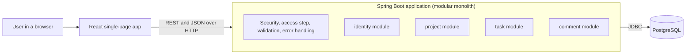
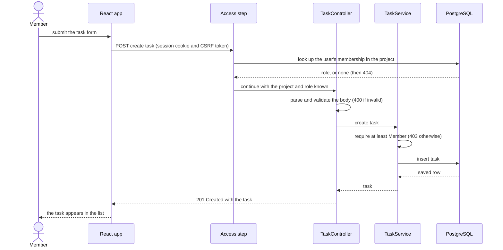
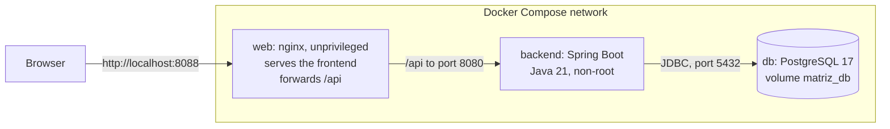
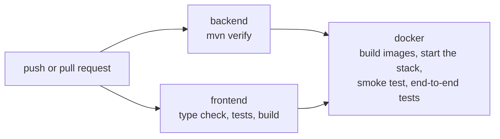

# Matriz: Architecture

Status: draft for Ficha 02. Related documents: [requirements.md](requirements.md), [user-stories.md](user-stories.md), [constraints.md](constraints.md), [database.md](database.md), [../openapi.yaml](../openapi.yaml).

This document records the architecture decision for the MVP and its reasons. All decisions in sections 3 and 4 were taken by the developer, after the analysis proposed them.

## 1. What drives the architecture

Taken from the requirements and constraints:

| Driver | Source | Consequence |
|---|---|---|
| One developer, one MVP, a short schedule | K-01, K-03 | Prefer the simplest structure that works; avoid operational overhead. |
| Small scale: tens of users, thousands of tasks | A-12 | No need for independent scaling of parts. |
| Rules that cut across all data: every request is authenticated and authorised against a project role | S-01, S-02, NFR-01 | Authorisation must be one shared mechanism, not repeated per feature. |
| Consistent deletion: no orphaned data | AC-11.1 | Related data should live in one database with referential integrity. |
| One organisation, one installation | A-03 | No multi-tenancy. |
| Requirements still partly assumed | A-01 to A-25 | The domain may change; boundaries must be cheap to move. |
| Reproducible start from a clean checkout, also in containers | NFR-10, K-08 | Few moving parts to start and test. |

## 2. Options considered

| Criterion | Monolith | Modular monolith | Microservices |
|---|---|---|---|
| Complexity | Lowest at the start | Low, needs discipline on module boundaries | High: network calls, contracts, failure handling |
| Scalability | Whole app only | Whole app only | Each service independently |
| Maintenance | Degrades as the code grows; boundaries blur | Clear boundaries inside one code base | Clear boundaries, but many repositories or pipelines to maintain |
| Deployment | One unit | One unit | Many units, each with its own pipeline |
| Cost to run | Lowest | Lowest | Highest (infrastructure, monitoring) |
| Team autonomy | Low | Medium | High, but only useful with several teams |
| Data consistency | One database, transactions | One database, transactions | Separate databases: referential integrity is lost between services |
| Fit for a one-person MVP | Good | **Good** | Poor |

**Why not the plain monolith.** It would work for the MVP, but without module boundaries the authorisation rule (S-02) tends to get copied into each controller, which is exactly where access-control mistakes appear. The extra structure costs very little.

**Why not microservices.** The benefits (independent scaling, autonomous teams, separate deployments) answer problems Matriz does not have. Their costs would land on a single developer: contracts between services, distributed failures, and the loss of database-level integrity, which Matriz needs for clean deletion (AC-11.1) and for the membership rules.

Also considered and not chosen: serverless and event-driven styles. Nothing in the requirements needs asynchronous reactions or per-function scaling (notifications and activity history are out of scope).

## 3. Decision

**Architecture style: modular monolith, organised by domain** (identity, project, task, comment). One deployable application, one database, strict module boundaries.

- Status: **Decided** (by the developer).
- Context: sections 1 and 2.
- Consequences:
  - (+) One deployment, one database, local method calls, transactions across modules, simple debugging and testing.
  - (+) If a part ever needs to be split out, the module boundaries make that possible.
  - (−) The whole application scales and deploys as one unit.
  - (−) The boundaries only hold if they are enforced. Mitigation: the dependency rules in section 5, checked in code review, and possibly an automated architecture test.
  - (−) A shared database makes it easy to read another module's tables directly. Rule: a module reads and writes only the tables it owns, and asks other modules through their public interface. The only exceptions are the three listed in section 5.

## 4. Technology choices

### 4.1 Decided

| Area | Choice |
|---|---|
| Backend | Java with Spring Boot (including Spring Security and Spring Data JPA) |
| Frontend | React |
| Database | PostgreSQL |
| API style | REST over HTTP with JSON, documented with OpenAPI 3.1 |

### 4.2 Further decisions (confirmed by the developer)

These resolve the items that were pending in [constraints.md](constraints.md), section 4. Each is the simplest option that satisfies the requirements.

| Topic | Decision | Reason |
|---|---|---|
| Authentication | Server-side session with an HTTP-only cookie, created by a JSON login endpoint (`POST /auth/login`). CSRF protection on, same-site cookie. | Logout invalidates the session on the server (AC-01.4), which tokens make harder. The browser stores no credential that scripts can read. Sessions are held in memory, so a backend restart requires logging in again (acceptable for the MVP). |
| Password hashing | BCrypt through Spring Security's password encoder. Minimum length 8 (S-14). | Established, built in, salted. |
| Session lifetime | Expires after 30 minutes of inactivity (S-15). | Short enough to limit exposure, long enough for normal work. |
| Transport | HTTPS outside local development (S-16). | Credentials must not travel in clear. |
| Frontend language | TypeScript, built with Vite, routing with React Router. | Types catch mismatches with the API contract early. |
| Frontend structure | Feature folders (projects, tasks, dashboard, auth); shared components for forms and messages; one place for the API base URL. | Matches the module split in the backend and the reuse required in Ficha 03. |
| Java and build | A current LTS Java release (21 or later), Maven. | Mainstream, well supported. |
| Identifiers | Numeric identifiers generated by the database. | Simple and matches the sample contract. Access control never relies on identifiers being hard to guess (S-02). |
| Database migrations | Flyway, SQL migrations in the repository. | Reproducible schema (NFR-10, Ficha 03). |
| API conventions | Base path `/api/v1`. Collections paginated with `page` and `size` (default 20, maximum 100). The one exception is the member list of a project, which is not paginated because a project has few members and no cap is enforced. Errors in the standard Problem Details JSON format with a field-error list for validation problems. | Consistent clients, and error bodies that leak nothing internal (CC-02). |
| Testing | Unit: JUnit 5 and Mockito (backend), Vitest (frontend). Integration: Spring Boot test against a real PostgreSQL in a disposable container. End to end: Playwright. | Covers the three levels required in Ficha 04, with a database that behaves like production. |
| Containers and CI | Docker Compose runs three services (`db`, `backend`, `web`; see the deployment view in section 5). A GitHub Actions pipeline tests the backend and the frontend and, only when both pass, builds the images, smoke-tests the stack and runs the end-to-end tests. | One command starts everything (NFR-10); the pipeline fails when a required test fails, and then no image is built. |

## 5. Components and responsibilities

| Component | Responsibility |
|---|---|
| **React app** | Screens: login, dashboard (the project list), project detail and task detail. Forms and their validation for user feedback, loading, empty and error states, calls to the API. Contains no business rules: it only improves usability. |
| **Security, access step, validation, error handling** (shared) | Authentication of every request; the request-level **access step** (described below); input validation; conversion of failures into the standard error format. |
| **identity module** | Users, login and logout, the current user. Owns the user table. |
| **project module** | Projects, their memberships and roles, and **progress** (the computed percentage and the manual override). Owns the project and membership tables. Provides the **access policy** used by every other module: "does this user have at least this role on this project?" |
| **task module** | Tasks and their assignees. Owns the task and assignment tables. |
| **comment module** | Comments on tasks. Owns the comment table. |
| **PostgreSQL** | Persistence and referential integrity, including cascading deletion. |

Inside each module the layers are the same: controller (HTTP and request or response objects), service (business rules and the role check for the operation), repository (database access). Controllers never touch repositories directly. Persistence entities are not returned through the API.

### Dependency rules

| Module | May depend on |
|---|---|
| identity | nothing |
| project | identity. It also **defines two ports** (see below) that the task module implements, so the compile-time dependency still points from task to project. |
| task | project (access policy, project lookup, the ports it implements), identity |
| comment | project (access policy), identity. It has **no compile-time dependency on the task module**: a comment holds the task's identifier as a plain number. |

No module depends on another that depends on it (no cycles).

As built, the comment routes (`/tasks/{taskId}/comments`) are protected by the task module's access step, because that step is attached to every path under `/tasks/{taskId}`. The comment module therefore relies on that path pattern at run time, not on a call. The authorisation tests of the comment API (a non-member gets `404`, also with an invalid body) guard this. The task module also asks the access policy for the role of **another** user (`ProjectAccess.roleOf`), to check that someone can be assigned to a task; this is part of the access policy, not a third mechanism.

**Port 1, task counts (read).** The project module needs the number of tasks per status to build its progress and the dashboard cards. It defines a small interface `TaskCounts` ("counts per status for a project"); the task module implements it.

**Port 2, membership changes (event).** When a member is removed from a project or demoted to Viewer, their assignments in that project must go. The project module publishes an in-process event (`MembershipChanged`); a listener in the task module (`MembershipChangeListener`) deletes its own assignments, in the transaction of the change. The project module never calls the task module. As built, the event is published for both removal and demotion; on removal the database cascade has already removed the rows, so the listener finds nothing to do.

### Exceptions to "a module touches only its own tables"

| # | Case | How it is handled |
|---|---|---|
| 1 | Deleting a project deletes its tasks, assignments and comments. | Database cascade along the foreign keys. |
| 2 | Removing a member deletes that member's assignments in the project. | Database cascade from the membership row to the assignments (composite foreign key, see [database.md](database.md)). |
| 3 | Demoting a member to Viewer deletes their assignments in the project. | Port 2: an event handled by the task module, which deletes its own rows. |

### The access step and the order of checks

Every operation on a project or on anything inside it follows the same order:

1. **Identify the user** from the session (never from the request body).
2. **Access step**, a request-level step keyed by the identifiers in the path, before the body is read. It finds the project that owns the target (a task is resolved to its project first) and looks up the user's membership. No such resource, or no membership, gives `404`.
3. **Parse and validate the body.** An invalid body gives `400`: a field that is not in the contract, a value of the wrong JSON type (a number for text, text for a number, a decimal for a whole number), or a value that breaks a rule.
4. **Role check in the service.** If the user's role is below the operation's minimum role, `403`; otherwise the operation runs.

The resulting order is `404`, then `400`, then `403`. A non-member therefore never learns whether a project exists by sending a malformed body (CC-05), and a Viewer who sends an invalid body gets `400`, which reveals nothing because a Viewer already has access.

This is the single place where the permission matrix in [requirements.md](requirements.md) is implemented, which is what protects against changing identifiers in requests (EC-03, CC-03).

### Example flow: create a task

### Deployment: the containers and the pipeline

`docker compose up -d --build` starts three services on one Compose network. Only `web` is published on the host (on `127.0.0.1`); the browser sees a single address, so the session and CSRF cookies need no cross-origin rules.

| Service | Image | Health check | Published |
|---|---|---|---|
| `db` | `postgres:17` | `pg_isready` | `127.0.0.1:5432`, for working on the code on the host |
| `backend` | built from `backend/Dockerfile` (Maven and JDK 21, then a slim Java 21 runtime, non-root) | the actuator health endpoint | no |
| `web` | built from `frontend/Dockerfile` (Node build, then `nginx-unprivileged`) | the application page | `127.0.0.1:8088` |

Each service waits for the one it depends on to be healthy. The data lives in the named volume `matriz_db`, so it survives removing and recreating the containers. nginx also sets the security headers and the Content-Security-Policy of the pages.

The GitHub Actions pipeline ([../.github/workflows/ci.yml](../.github/workflows/ci.yml)) runs on every push and pull request:

The `docker` job needs both of the others, so a failing test stops the pipeline before any image is built.

## 6. How the architecture meets the quality requirements

| Requirement | How |
|---|---|
| NFR-01, S-02, CC-03 (authorisation on every request) | One access step that resolves every target to its project before the body is read, and one role check in each service. |
| CC-05 (no existence leak) | The order of checks: `404`, then `400`, then `403`. |
| NFR-02, S-04 (hashed passwords) | Password encoder in the identity module only. |
| NFR-03, S-03 (server decides owner and author) | Services take the user from the session; request objects have no owner or author fields, and unknown fields are refused. |
| NFR-04, S-05, CC-02 (validation, no leaked errors) | Validation in the services (`FieldValidation`); the JSON mapper refuses unknown fields and wrongly typed values (`application.yml` and `StrictJsonConfig`); one error handler with fixed texts, also for unknown routes and bad query values. |
| NFR-06 (persistence) | PostgreSQL; schema by migrations. |
| NFR-07, NFR-08 (usable, consistent UI) | A single API client in the frontend; the UI updates from the API's confirmed response. |
| NFR-09, NFR-10 (testable, reproducible) | Layers can be unit tested; integration tests run against a real database; Docker Compose runs the whole application. |
| AC-11.1 (no orphaned data) | Foreign keys with cascading deletion, see [database.md](database.md). |

## 7. Risks and open points

- **Module boundaries erode** over time in a single code base. Mitigation: the dependency rules above, enforced in review.
- **In-memory sessions** are lost on restart. Acceptable for the MVP, and users simply log in again. A database-backed session store would be the next step.
- **Authorisation depends on two things being complete:** the access step must cover every route that has an identifier in its path, and every service must assert the role for its operation. A route that forgets either is a vulnerability. Mitigation: authorisation tests for every write endpoint and a test for CC-05 (written with each increment, with mutation checks that disable the guard; see [verification.md](verification.md)), and a review checklist.
- **Two cross-module mechanisms** (the `TaskCounts` port and the membership event) must stay the only ones. Any new need to cross a module boundary is a design decision to record here.
- **No brute-force protection on login** (accepted, see [constraints.md](constraints.md), section 6).
- **Docker depends on Docker Desktop running** (checked: Docker 29.1.3 and Compose 2.40 work from WSL). It is needed for the integration tests and for running the application in containers. If it is not running, integration tests cannot start; a separate test database is the fallback.
