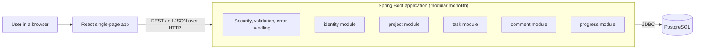
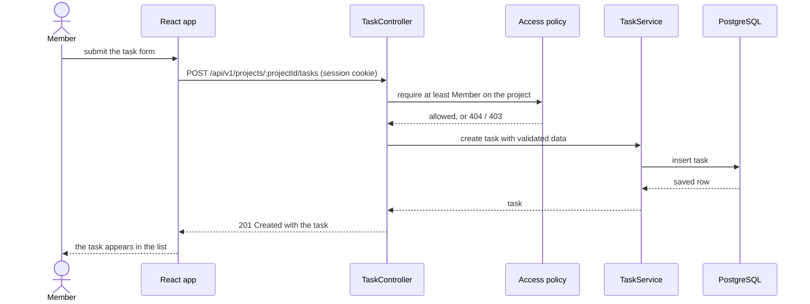

# Matriz: Architecture

Status: draft for Ficha 02. Related documents: [requirements.md](requirements.md), [user-stories.md](user-stories.md), [constraints.md](constraints.md), [database.md](database.md).

This document records the architecture decision for the MVP and its reasons. All decisions in sections 3 and 4 were taken by the developer, after the analysis proposed them.

## 1. What drives the architecture

Taken from the requirements and constraints:

| Driver | Source | Consequence |
|---|---|---|
| One developer, one MVP, a short schedule | K-01, K-03 | Prefer the simplest structure that works; avoid operational overhead. |
| Small scale: tens of users, thousands of tasks | A-12 | No need for independent scaling of parts. |
| Rules that cut across all data: every request is authenticated and authorised against a project role | S-01, S-02, NFR-01 | Authorisation must be one shared mechanism, not repeated per feature. |
| Consistent deletion: no orphaned data | AC-11.1 | Related data should live in one database with referential integrity. |
| One organisation, one installation | A-03 | No multi-tenancy. |
| Requirements still partly assumed | A-01 to A-22 | The domain may change; boundaries must be cheap to move. |
| Reproducible start from a clean checkout; containers later | NFR-10, K-08 | Few moving parts to start and test. |

## 2. Options considered

| Criterion | Monolith | Modular monolith | Microservices |
|---|---|---|---|
| Complexity | Lowest at the start | Low, needs discipline on module boundaries | High: network calls, contracts, failure handling |
| Scalability | Whole app only | Whole app only | Each service independently |
| Maintenance | Degrades as the code grows; boundaries blur | Clear boundaries inside one code base | Clear boundaries, but many repositories or pipelines to maintain |
| Deployment | One unit | One unit | Many units, each with its own pipeline |
| Cost to run | Lowest | Lowest | Highest (infrastructure, monitoring) |
| Team autonomy | Low | Medium | High, but only useful with several teams |
| Data consistency | One database, transactions | One database, transactions | Separate databases: referential integrity is lost between services |
| Fit for a one-person MVP | Good | **Good** | Poor |

**Why not the plain monolith.** It would work for the MVP, but without module boundaries the authorisation rule (S-02) tends to get copied into each controller, which is exactly where access-control mistakes appear. The extra structure costs very little.

**Why not microservices.** The benefits (independent scaling, autonomous teams, separate deployments) answer problems Matriz does not have. Their costs would land on a single developer: contracts between services, distributed failures, and the loss of database-level integrity, which Matriz needs for clean deletion (AC-11.1) and for the membership rules.

Also considered and not chosen: serverless and event-driven styles. Nothing in the requirements needs asynchronous reactions or per-function scaling (notifications and activity history are out of scope).

## 3. Decision

**Architecture style: modular monolith, organised by domain** (identity, project, task, comment, progress). One deployable application, one database, strict module boundaries.

- Status: **Decided** (by the developer).
- Context: sections 1 and 2.
- Consequences:
  - (+) One deployment, one database, local method calls, transactions across modules, simple debugging and testing.
  - (+) If a part ever needs to be split out, the module boundaries make that possible.
  - (−) The whole application scales and deploys as one unit.
  - (−) The boundaries only hold if they are enforced. Mitigation: dependency rules in section 5, checked in code review, and possibly an automated architecture test.
  - (−) A shared database makes it easy to read another module's tables directly. Rule: a module reads and writes only the tables it owns, and asks other modules through their public interface.

## 4. Technology choices

### 4.1 Decided

| Area | Choice |
|---|---|
| Backend | Java with Spring Boot (including Spring Security and Spring Data JPA) |
| Frontend | React |
| Database | PostgreSQL |
| API style | REST over HTTP with JSON, documented with OpenAPI 3.1 |

### 4.2 Further decisions (confirmed by the developer)

These resolve the items that were pending in [constraints.md](constraints.md), section 4. Each is the simplest option that satisfies the requirements.

| Topic | Proposal | Reason |
|---|---|---|
| Authentication | Server-side session with an HTTP-only cookie (Spring Security form login or a JSON login endpoint). CSRF protection on, same-site cookie. | Logout invalidates the session on the server (AC-01.4), which tokens make harder. The browser stores no credential that scripts can read. Sessions are held in memory, so a backend restart requires logging in again (acceptable for the MVP). |
| Password hashing | BCrypt through Spring Security's password encoder. Minimum length 8 (S-14). | Established, built in, salted. |
| Session lifetime | Expires after 30 minutes of inactivity (S-15). | Short enough to limit exposure, long enough for normal work. |
| Transport | HTTPS outside local development (S-16). | Credentials must not travel in clear. |
| Frontend language | TypeScript, built with Vite, routing with React Router. | Types catch mismatches with the API contract early. |
| Frontend structure | Feature folders (projects, tasks, dashboard, auth); shared components for forms and messages; one place for the API base URL. | Matches the module split in the backend and the reuse required in Ficha 03. |
| Java and build | A current LTS Java release (21 or later), Maven. | Mainstream, well supported. |
| Identifiers | Numeric identifiers generated by the database. | Simple and matches the sample contract. Access control never relies on identifiers being hard to guess (S-02). |
| Database migrations | Flyway, SQL migrations in the repository. | Reproducible schema (NFR-10, Ficha 03). |
| API conventions | Base path `/api/v1`. Collections paginated with `page` and `size` (default 20, maximum 100). Errors in the standard Problem Details JSON format with a field-error list for validation problems. | Consistent clients, and error bodies that leak nothing internal (CC-02). |
| Testing | Unit: JUnit 5 and Mockito (backend), Vitest (frontend). Integration: Spring Boot test against a real PostgreSQL in a disposable container. End to end: Playwright. | Covers the three levels required in Ficha 04, with a database that behaves like production. |
| Containers and CI | Docker Compose and GitHub Actions, in the delivery stage. | Ficha 05. |

## 5. Components and responsibilities

| Component | Responsibility |
|---|---|
| **React app** | Screens (login, dashboard, project list, project detail, task detail), forms and their validation for user feedback, loading, empty and error states, calls to the API. Contains no business rules: it only improves usability. |
| **Security, validation, error handling** (shared) | Authentication of every request; conversion of failures into the standard error format; input validation. |
| **identity module** | Users, login and logout, the current user. Owns the user table. |
| **project module** | Projects and their memberships and roles. Owns the project and membership tables. Provides the **access policy** used by every other module: "does this user have at least this role on this project?" |
| **task module** | Tasks and their assignees. Owns the task and assignment tables. |
| **comment module** | Comments on tasks. Owns the comment table. |
| **progress module** | Read-only: task counts per status and computed progress per project, for the dashboard. Owns no tables. |
| **PostgreSQL** | Persistence and referential integrity, including cascading deletion of a project's data. |

Inside each module the layers are the same: controller (HTTP and request or response objects), service (business rules and authorisation), repository (database access). Controllers never touch repositories directly. Persistence entities are not returned through the API.

### Dependency rules

| Module | May depend on |
|---|---|
| identity | nothing |
| project | identity |
| task | project (access policy and project lookup), identity |
| comment | task, project (access policy), identity |
| progress | project, task |

No module depends on another that depends on it (no cycles). Deleting a project is the one case where the project module affects other modules' data: this is handled by database-level cascade, not by the project module calling the others.

### Authorisation in one place

Every operation on a project or on anything inside it follows the same steps:

1. Identify the user from the session (never from the request body).
2. Find the project that owns the target (a task or comment is resolved to its project first).
3. Ask the access policy for the user's role on that project. No membership gives `404`; a role too low for the action gives `403`.
4. Only then validate the input and run the operation.

This is the single place where the permission matrix in [requirements.md](requirements.md) is implemented, which is what protects against changing identifiers in requests (EC-03, CC-03).

### Example flow: create a task

## 6. How the architecture meets the quality requirements

| Requirement | How |
|---|---|
| NFR-01, S-02, CC-03 (authorisation on every request) | One access policy used by all modules; resources resolved to their project before any check. |
| NFR-02, S-04 (hashed passwords) | Password encoder in the identity module only. |
| NFR-03, S-03 (server decides owner and author) | Services take the user from the session; request objects have no owner or author fields. |
| NFR-04, S-05, CC-02 (validation, no leaked errors) | Validation in the request objects and services; one error handler. |
| NFR-06 (persistence) | PostgreSQL; schema by migrations. |
| NFR-07, NFR-08 (usable, consistent UI) | A single API client in the frontend; the UI updates from the API's confirmed response. |
| NFR-09, NFR-10 (testable, reproducible) | Layers can be unit tested; integration tests run against a real database; Docker Compose later. |
| AC-11.1 (no orphaned data) | Foreign keys with cascading deletion, see [database.md](database.md). |

## 7. Risks and open points

- **Module boundaries erode** over time in a single code base. Mitigation: the dependency rules above, enforced in review.
- **In-memory sessions** are lost on restart. Acceptable for the MVP, and users simply log in again. A database-backed session store would be the next step.
- **Authorisation depends on every service calling the access policy.** An endpoint that forgets it is a vulnerability. Mitigation: authorisation tests for every write endpoint (Ficha 04) and a review checklist.
- **No brute-force protection on login** (accepted, see [constraints.md](constraints.md), section 6).
- **Docker depends on Docker Desktop running** (checked: Docker 29.1.3 and Compose 2.40 work from WSL). It is needed for the integration tests (Ficha 04) and for containers (Ficha 05). If it is not running, integration tests cannot start; a separate test database is the fallback.
