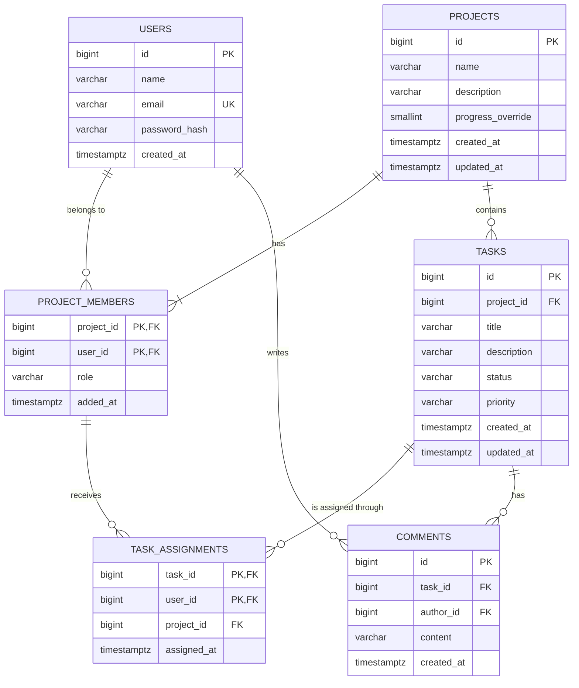

# Matriz: Data Model

Status: draft for Ficha 02. Related documents: [requirements.md](requirements.md), [user-stories.md](user-stories.md), [constraints.md](constraints.md), [architecture.md](architecture.md).

This is the conceptual and logical model for PostgreSQL. It contains no SQL: the schema is created by the Flyway migration `V1__create_schema.sql`, written from this model. The model is derived from the requirements of Matriz, not from example models. Everything that is a business rule or an assumption points to its source.

## 1. Entities

Types are conceptual. Limits come from assumption A-13 and apply to the **trimmed** value, counted in characters. The value stored is the trimmed one.

### users (owned by the identity module)

| Attribute | Type | Rules | Meaning |
|---|---|---|---|
| id | number | PK, generated | Identifier. |
| name | text | required, 1–100 | Display name. |
| email | text | required, up to 254, unique ignoring letter case | Login name and the way an Owner finds a user to add. |
| password_hash | text | required | Salted BCrypt hash (S-04). Never returned by the API. |
| created_at | timestamp with time zone | required | Creation time. |

### projects (project module)

| Attribute | Type | Rules | Meaning |
|---|---|---|---|
| id | number | PK, generated | Identifier. |
| name | text | required, 3–100 | Project name (FR-05). |
| description | text | optional, up to 1000; empty or whitespace-only is stored as null | Project description. |
| progress_override | whole number | optional, 0–100 | Manual progress set by the Owner (FR-25). Empty means "use the computed value". |
| created_at | timestamp with time zone | required | Creation time. |
| updated_at | timestamp with time zone | required | Last change. |

### project_members (project module)

Links users to projects and holds the role. **The Owner is also a row here**, with role `OWNER` (decision recorded in section 5).

| Attribute | Type | Rules | Meaning |
|---|---|---|---|
| project_id | number | PK part, FK to projects | The project. |
| user_id | number | PK part, FK to users | The member. |
| role | text | required, one of `OWNER`, `MEMBER`, `VIEWER` | The user's role in this project. |
| added_at | timestamp with time zone | required | When the user was added. |

### tasks (task module)

| Attribute | Type | Rules | Meaning |
|---|---|---|---|
| id | number | PK, generated | Identifier. |
| project_id | number | required, FK to projects | The one project the task belongs to (A-08). |
| title | text | required, 3–150 | Task title (FR-14). |
| description | text | optional, up to 2000; empty or whitespace-only is stored as null | Task description. |
| status | text | required, one of `TODO`, `IN_PROGRESS`, `DONE`; default `TODO` | Task status (A-09). |
| priority | text | required, one of `LOW`, `MEDIUM`, `HIGH`; default `MEDIUM` | Task priority (A-09). |
| created_at | timestamp with time zone | required | Creation time. |
| updated_at | timestamp with time zone | required | Last change. |

The pair (id, project_id) is also unique. This is needed by task_assignments, see below.

### task_assignments (task module)

Links tasks to the users responsible for them (many users per task, many tasks per user).

| Attribute | Type | Rules | Meaning |
|---|---|---|---|
| task_id | number | PK part, FK to tasks | The task. |
| user_id | number | PK part | The assigned user. |
| project_id | number | required | The task's project, repeated on purpose (see section 3). |
| assigned_at | timestamp with time zone | required | When the assignment was made. |

### comments (comment module)

| Attribute | Type | Rules | Meaning |
|---|---|---|---|
| id | number | PK, generated | Identifier. |
| task_id | number | required, FK to tasks | The task commented on. |
| author_id | number | required, FK to users | The author, set by the server from the session (S-03). |
| content | text | required, 1–2000 | The comment text (FR-21). |
| created_at | timestamp with time zone | required | Creation time; shown to users. |

Task progress counts and the computed progress percentage are **not stored**: they are calculated from the tasks table when needed (FR-23, FR-24). Only the manual override is stored.

## 2. Relationships and cardinalities

| Relationship | Cardinality | Mandatory? | Notes |
|---|---|---|---|
| user — project_members | one user has zero or many memberships | A membership needs a user | A user may be in many projects. |
| project — project_members | one project has one or many memberships | A project always has at least its Owner | A membership belongs to exactly one project. |
| project — tasks | one project has zero or many tasks | A task needs a project | A task belongs to exactly one project (A-08). |
| task — task_assignments | one task has zero or many assignments | An assignment needs a task | A task may have no assignee (A-11). |
| member — task_assignments | one membership has zero or many assignments | An assignment needs a membership in the task's project | This is what makes "assignees must be project members" a database rule. |
| task — comments | one task has zero or many comments | A comment needs a task | |
| user — comments | one user writes zero or many comments | A comment needs an author | The comment stays when its author leaves the project (A-11). |

Many-to-many relationships and how they are resolved: users ↔ projects through **project_members** (which also carries the role), and users ↔ tasks through **task_assignments**.

## 3. Entity-relationship diagram

In the diagram, an assignment refers to a **membership** (project_id and user_id together), not to a plain user. The `project_id` in `TASK_ASSIGNMENTS` is deliberately repeated from the task: two composite foreign keys use it, one to the task (task_id, project_id) and one to the membership (project_id, user_id). Together they guarantee that an assignment can only exist for a user who is a member of the very project the task belongs to.

## 4. Integrity rules

### 4.1 Enforced by the database

| Rule | Mechanism | Requirement |
|---|---|---|
| A project has **at most one Owner** | Unique index on project_id restricted to rows with role `OWNER` | FR-13, A-06 |
| A user is a member of a project only once | Primary key (project_id, user_id) | AC-03.4 |
| A user is assigned to a task only once | Primary key (task_id, user_id) | FR-20, AC-07.3 |
| An assignee must be a member of the task's project | The two composite foreign keys described in section 3 | FR-20, AC-07.4 |
| Role, status and priority only take the allowed values | Check constraints | A-09 |
| Required fields are present; lengths within limits; not whitespace-only | Not-null and check constraints on the trimmed length (backup to the application's validation) | NFR-04, A-13 |
| Progress override is between 0 and 100 | Check constraint | FR-25 |
| Email is unique regardless of letter case | Unique index on the lower-case email | FR-01 |
| **Deleting a project deletes its memberships, tasks, assignments and comments** | Cascading deletion along the foreign keys | FR-08, AC-11.1 |
| **Removing a member deletes their assignments in that project** | Cascading deletion from the membership row to its assignments | FR-12, AC-03.5 |
| Deleting a task deletes its assignments and comments | Cascading deletion | AC-05.4 |
| A user cannot be deleted while memberships, assignments or comments refer to them | Foreign keys without cascade | (user deletion is out of scope, see section 7) |

### 4.2 Enforced by the application (the database cannot express them simply)

| Rule | Where | Requirement |
|---|---|---|
| A new project gets its Owner row in the **same transaction** as the project | Project service | FR-05, AC-02.1 |
| The Owner cannot be removed or demoted; no ownership transfer | Project service | FR-13, AC-03.6 |
| A member **demoted to Viewer** loses their assignments in that project | Task module, reacting to an event published by the project module (the membership row stays, so no cascade happens; see [architecture.md](architecture.md), section 5) | FR-11, AC-03.8 |
| Viewers cannot be assigned to tasks | Task service (the database only knows the user is a member) | FR-20, AC-07.4 |
| Who may do what according to the role | The access policy (architecture.md, section 5) | permission matrix |
| Trimming of Unicode whitespace; the progress percentage rounding | Services | NFR-04, FR-24 |
| Only existing users can be added as members | Project service | AC-03.7 |

## 5. Design decisions

| Decision | Choice | Reason | Trade-off |
|---|---|---|---|
| Where the Owner is stored | As a membership row with role `OWNER`, with a unique index for at most one | All access decisions read one table, so the access policy has a single source of truth. | Needs the unique index and a transaction at project creation; a bug could create a project without an Owner row. |
| Enumerated values | Text columns with check constraints, not database enum types | Changing the allowed values is a simple migration. | Slightly less compact than enums. |
| Assignments refer to memberships | Repeated project_id and two composite foreign keys | The database itself rejects assignments to non-members and removes them when the member is removed. | One redundant column, and slightly more complex keys. |
| Progress | Counts computed on demand; only the manual override is stored | Stored counts could become inconsistent with the tasks. | The dashboard needs an aggregate query, which is fine at the expected size (A-12). |
| Identifiers | Numeric, database-generated | Simple; access control does not rely on them being secret. | Easy to guess, so the authorisation checks must never be skipped. |
| Dates | Time stamps with time zone, set by the server | Unambiguous times; the client cannot forge dates (S-03). | |

## 6. Indexes (for the expected queries)

| Index | Supports |
|---|---|
| project_members(user_id) | Listing the projects a user can access; the dashboard (FR-06, FR-23). |
| tasks(project_id, status, priority) | Listing a project's tasks, filters and counts per status (FR-18, FR-23). |
| comments(task_id, created_at) | Listing a task's comments in order (AC-08.4). |
| task_assignments(user_id) | Finding what a user is assigned to when they are removed. |
| projects(name) searched case-insensitively | Search by name (FR-09); a plain scan is acceptable at the expected size, so this index is optional. |

## 7. Traceability

| Entity | Requirements and stories |
|---|---|
| users | FR-01 to FR-04; US-01; S-04 |
| projects | FR-05 to FR-09, FR-24, FR-25; US-02, US-10, US-11 |
| project_members | FR-10 to FR-13, FR-27; US-03; the permission matrix |
| tasks | FR-14 to FR-18, FR-23, FR-26; US-04, US-05, US-06, US-09 |
| task_assignments | FR-19, FR-20; US-07 |
| comments | FR-21, FR-22; US-08 |

## 8. Assumptions and pending points

The assumptions below are also registered as A-23 to A-25 in [constraints.md](constraints.md).

- **Deleting users is out of scope** (no requirement mentions it). Because the foreign keys prevent it while related data exists, there is no accidental data loss, but there is also no way to remove a user. Deleting a user would also raise the privacy questions listed in A-21.
- **Letter-case rules for emails** are decided here as "case-insensitive", an assumption not stated in the requirements.
- **Name uniqueness:** project names are not unique, because nothing in the requirements asks for it. Two projects may share a name.
- **The exact SQL, migration files and demo data** are produced in Ficha 03. The two composite foreign keys and the partial unique index are the parts most worth testing there.
- **Concurrency:** two simultaneous changes to the same task are not handled (last write wins). No requirement asks for more.
